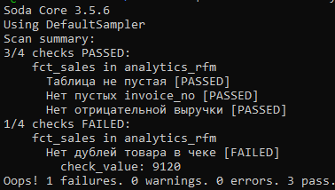

# Soda Core: Data Quality Demo

Pet-проект по настройке проверок качества данных (Data Quality) с помощью Soda Core.

## 🎯 Бизнес-задача
Настроить автоматические проверки для витрины `fct_sales` (e-commerce), чтобы выявлять проблемы с данными до того, как они попадут в отчеты.

## 🛠 Стек
- **Soda Core (3.5.6):** Инструмент для проверки качества данных (аналог Great Expectations).
- **PostgreSQL:** База данных, где лежит витрина `fct_sales`.
- **Apache Airflow (2.8.1):** Оркестрация пайплайна (Часть 2).

## 📊 Что было сделано (Часть 1: ручной запуск Soda)
1. Установлен Soda Core и драйвер для PostgreSQL.
2. Настроено подключение к базе `analytics_rfm` (файл `configuration.yml`).
3. Написаны 4 проверки (файл `checks.yml`):
   - Таблица не пустая.
   - Нет пустых `invoice_no`.
   - Нет отрицательной выручки.
   - Нет дублей товара в чеке (`invoice_no` + `stock_code`).

### 🔍 Результаты (найденный инцидент)
При запуске проверок **3 из 4 прошли успешно**. Проверка на дубликаты выявила **9120 случаев**, когда один и тот же товар встречается в чеке несколько раз. 

 

**Вывод:** В реальном проекте это требует либо агрегации данных (SUM по количеству), либо разбирательства с источником (почему дублируются строки). Soda Core позволяет быстро находить такие аномалии.

## 🚀 Часть 2: Soda Core в Airflow (Data Quality в пайплайне)

В Части 1 Soda запускался вручную. В Части 2 те же проверки встроены в **Airflow-пайплайн**: если Soda находит провал — таск падает, DAG останавливается. Это стандартный паттерн Data Quality в оркестрации.

### Что добавлено
- `dags/soda_quality_dag.py` — DAG Airflow (BashOperator вызывает `soda scan`).
- `configuration.docker.yml` — конфиг Soda для запуска из контейнера Airflow (хост `10.0.2.2`, т.к. PostgreSQL на Windows).
- `requirements.txt` — зависимости для установки в контейнер Airflow.

### Как подключить к существующему Airflow (standalone в Docker)

1. **Смонтировать папку проекта в контейнер Airflow.** В `docker-compose.yml` standalone Airflow добавь volume к сервисам `airflow-scheduler` и `airflow-webserver`:
   yaml
   
   volumes:
     - /path/to/soda-data-quality-demo:/opt/airflow/soda-project
  
